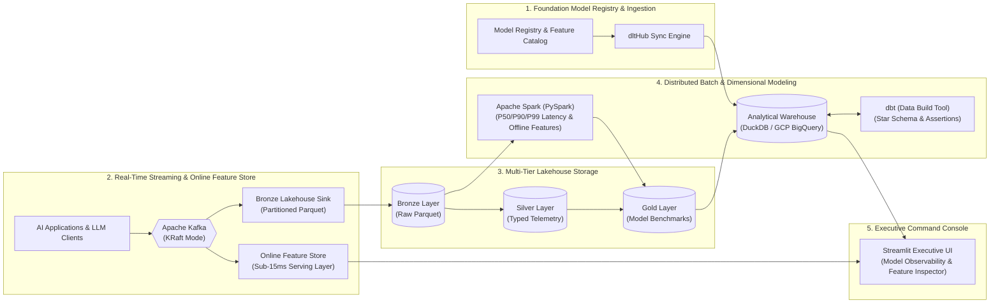

# NeuroLake — Real-Time ML Feature Store & GenAI Observability Lakehouse

[](https://python.org)
[](https://www.docker.com/)
[](https://kafka.apache.org/)
[](https://spark.apache.org/)
[](https://www.getdbt.com/)
[](https://kestra.io/)
[](https://github.com/Ghaberitsohaib/neurolake-data-platform/actions/workflows/ci.yml)

> **NeuroLake** is an enterprise-scale, production-ready Data Engineering platform specifically designed for **Generative AI & Machine Learning Operations (LLMOps)**. It provides real-time online feature extraction for low-latency (<15ms) model inference, captures distributed LLM telemetry, computes token costs and P90/P99 latency percentiles with Apache Spark, and audits RAG vector retrieval similarity across multiple foundation models.

---

## Architecture Diagram



---

## Key AI Data Engineering Concepts Implemented

| Domain Concept | Implementation in NeuroLake |
| :--- | :--- |
| **Real-Time Feature Store** | Ingests streaming inference events and computes rolling prompt token velocity, model affinity, and average retrieval relevance with sub-15ms lookup latency. |
| **LLM Cost & Token Observability** | Computes precise dollar burn rates across foundation models (GPT-4o, Claude 3.5 Sonnet, Llama 3 70B, Mistral Large 2) per 1,000 tokens. |
| **RAG Vector Search Telemetry** | Tracks Cosine similarity scores between prompt embeddings and knowledge base chunks, detecting retrieval drift and correlation with response latency. |
| **Distributed Percentile Benchmarking** | PySpark batch job calculating median (P50), tail (P90), and worst-case (P99) response latencies across thousands of distributed requests. |
| **Data Quality Assertions** | Automated **dbt tests** verifying non-negative token volumes, entity primary keys, and model referential integrity. |
| **Infrastructure as Code (IaC)** | Modular **Terraform** configurations provisioning GCP Cloud Storage buckets and partitioned BigQuery datasets. |

---

## Repository Structure

```
neurolake-data-platform/
├── docker-compose.yml              # Cluster: Kafka, MinIO, Spark, Kestra, Dashboard
├── requirements.txt                # Python libraries
├── terraform/                      # Terraform GCP BigQuery & GCS Buckets
├── ingestion/                      # dltHub pipelines for Model Registry & Feature Catalog
├── streaming/                      # Kafka AI event producer, online feature extractor, lakehouse sink
├── batch/                          # PySpark model benchmarking & offline training snapshots
├── analytics_dbt/                  # dbt models (stg_*, fct_*) & automated tests
├── orchestration/flows/            # Kestra declarative workflow DAGs
├── data_platform/                  # Streamlit Executive GenAI & Feature Store UI
├── scripts/                        # Automated pipeline execution scripts
└── tests/                          # Automated pytest suite
```

---

## Quickstart: Running in 30 Seconds

### 1. Install dependencies:
```bash
pip install -r requirements.txt
```

### 2. Execute the entire pipeline locally:
```bash
python scripts/run_pipeline.py
```

### 3. Launch the Executive AI & Feature Store Dashboard:
```bash
streamlit run data_platform/dashboard.py
```
Open **`http://localhost:8501`** to view real-time foundation model benchmarks, query online entity features, and inspect token consumption analytics.

---

## Full Docker Multi-Container Cluster

```bash
docker compose up -d
```
- **Streamlit Command Console**: `http://localhost:8502`
- **Kafka Stream Monitor**: `http://localhost:9092`
- **MinIO Lakehouse Console**: `http://localhost:9001`
